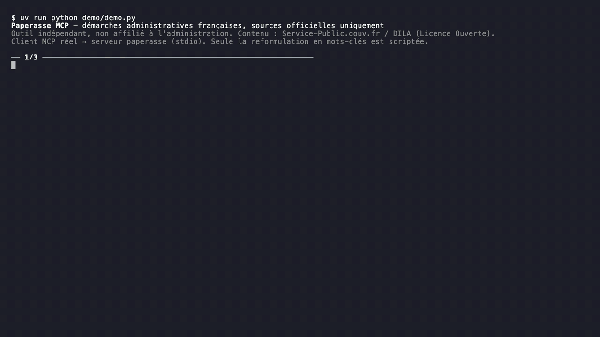

# Paperasse MCP

[](https://github.com/medkouritahaparis-create/paperasse-mcp/actions/workflows/ci.yml)

An open-source [MCP](https://modelcontextprotocol.io) server that lets AI assistants answer questions about French administrative procedures **from official sources only**, with a citable link and last update date for every answer. It covers the guides for individuals (service-public.gouv.fr) and for professionals and the self-employed (entreprendre.service-public.gouv.fr).

> **Status:** early development (v0.1.0). Both official feeds, keyword search with synonyms, a dev/test search eval and CI work. There is no hosted version, by design: you install it on your machine (about a minute), so your questions stay local.

## Demo



A real MCP client calling the server: question → `search_fiche` → `get_fiche` → official text with its link and update date (15 s, sped up). The full 2-minute video, which also shows an English freelancer question with a `low_confidence` retry and an off-topic question, is attached to the [v0.1.0 release](https://github.com/medkouritahaparis-create/paperasse-mcp/releases/tag/v0.1.0). In the demo the keyword rewriting an assistant would do is scripted and labelled; see [demo/](demo/).


https://github.com/user-attachments/assets/6e271201-e9ae-48b5-8b47-abf22a0778f8


## Why

French administrative procedures are hard to navigate, and general-purpose AI assistants answer questions about them from memory: rules change every year (amounts, thresholds, deadlines), and a confident but outdated answer about the CAF, taxes or a residence permit can cost someone money or a deadline. The official guides already exist, are kept up to date by the DILA and are open data.

Paperasse gives an assistant those guides instead of its memory. It searches the official fiches, returns their text word for word with the official link and last update date, and says when it found nothing relevant. The assistant explains and cites; the server never writes or rewords the content.

## Try it

You need [uv](https://docs.astral.sh/uv/) and about a minute to download the official feeds and build the index:

```bash
git clone https://github.com/medkouritahaparis-create/paperasse-mcp.git
cd paperasse-mcp
uv sync
uv run python -m paperasse.ingest   # download both official feeds (about 35 MB) into data/
uv run python -m paperasse.store    # build the search index data/paperasse.db
```

To refresh the data later (the official feeds are updated daily), run the same two commands again.

**Claude Code:** open Claude Code in the repo folder: [.mcp.json](.mcp.json) registers the server. From anywhere else:

```bash
claude mcp add paperasse -- uv --directory /absolute/path/to/paperasse-mcp run main.py
```

**Claude Desktop:** add this to `claude_desktop_config.json` (macOS: `~/Library/Application Support/Claude/`, Windows: `%APPDATA%\Claude\`), keeping your other servers, then restart Claude Desktop:

```json
{
  "mcpServers": {
    "paperasse": {
      "command": "uv",
      "args": ["--directory", "/absolute/path/to/paperasse-mcp", "run", "main.py"]
    }
  }
}
```

If Claude Desktop can't find `uv`, use its full path (the output of `which uv`) as `command`.

Then ask, for example: *"Je suis étudiant, est-ce que j'ai droit aux APL ?"* or *"How do I declare my micro-entrepreneur revenue?"*. The answer should cite a service-public.gouv.fr or entreprendre.service-public.gouv.fr link.

## Tools

| Tool | What it does |
|---|---|
| `search_fiche(query, audience="all", limit=5)` | Best matching fiches: id, title, summary, official URL, last update date and a `match` score. `audience` is `"all"`, `"particuliers"` (individuals) or `"professionnels"` (businesses, self-employed); the URL is the page on that audience's site. Says `low_confidence: true` when the best result probably doesn't answer the question |
| `get_fiche(id, offset=0)` | Full official text of a fiche, with its URL on each site, update date, online services and legal sources; long fiches come in pages |

## Search quality

Measured with [evals/questions.jsonl](evals/questions.jsonl): 93 questions whose expected fiches were labelled by hand from fiche **titles**, never from search results. They are split into **dev** (65, used to tune search) and **test** (28, only reported, never tuned on). Current results on the **test split**, 2026-10-27 (search code `8b2687b`, 3,673 fiches from both feeds):

| Test split | n | Top-1 | Top-3 | MRR@10 |
|---|---|---|---|---|
| Keywords, as clients are told to send them ("APL étudiant") | 11 | 64% | 73% | 0.72 |
| Full sentences, sent as is ("Comment avoir un garant gratuit pour louer ?") | 15 | 33% | 53% | 0.46 |
| Freelancers / micro-entrepreneurs (keywords and sentences) | 8 | 38% | 50% | 0.47 |
| **All answerable** | 26 | **46%** | **62%** | **0.57** |
| *Same questions rewritten by an LLM client (Claude Haiku 5.5, `--rewrite`)* | 26 | *not measured yet* | | |

On dev (61 answerable): 54% top-1, 70% top-3, MRR 0.63. Full report: [evals/results/2026-10-27-8b2687b-q0c79b3.md](evals/results/2026-10-27-8b2687b-q0c79b3.md).

**What moved the numbers** (each change measured before and after; every option tried, kept or rejected, is in [docs/decisions.md](docs/decisions.md)):

| Change | Measured on | Before → after |
|---|---|---|
| Length prior: main guides outrank short Q&A spin-offs | first 48 questions | top-1 44% → 62%, top-3 75% → 79% |
| *Entreprendre* feed + `audience="all"` | 13 freelance questions | top-3 0/13 → 4/13 |
| Synonyms run as query variants (auto-entrepreneur → micro-entrepreneur, chômage → ARE, enceinte → grossesse) | dev | top-1 32 → 33, top-3 41 → 43 of 61 |
| same | **test** (reported once) | top-1 42% → 46%, top-3 58% → 62%; freelance top-1 2/8 → 3/8, top-3 3/8 → 4/8 |

Full sentences are the weak spot (33% top-1 on test). The `search_fiche` docstring tells the client model to rewrite questions into official keywords. The `--rewrite` mode measures exactly that with Claude Haiku and needs an API key; it hasn't been run yet. If rewritten sentences stay weak, the next step is hybrid BM25 + multilingual embeddings fused with RRF ([plan](docs/decisions.md)).

`low_confidence` is set on all 6 questions that have no good answer (off-topic, English). On test it is also set on 3 of 12 questions whose rank-1 result is right (false alarms).

Reproduce:

```bash
uv run python -m evals.run                                  # writes evals/results/<date>-<code>-q<question set>.md
uv run --group eval python -m evals.run --rewrite           # needs ANTHROPIC_API_KEY in .env; ~$0.03, cached afterwards
```

The official feeds are updated daily, so numbers can move slightly with the data. Each report records the code commit, the question set and the data snapshot. The test split is small: one question is about 4 points.

## Development

```bash
uv run pytest                        # tests (no network, no data needed)
uv run mcp dev main.py               # inspect the tools in the MCP Inspector
uv run python -m evals.run           # search eval, writes evals/results/
uv run python demo/demo.py           # terminal demo (a real MCP client); vhs demo/demo.tape records it
```

CI ([.github/workflows/ci.yml](.github/workflows/ci.yml)) runs the tests on every push and pull request. They need no network, data or API key.

Design choices, with the options considered and the numbers behind them, are in [docs/decisions.md](docs/decisions.md).

## Roadmap

- [x] Ingest both official feeds (*Particuliers*, *Entreprendre*) into clean, verbatim fiches
- [x] `search_fiche` / `get_fiche`: SQLite FTS5 (BM25), length prior, `low_confidence`, measured synonyms
- [x] Search eval with a dev/test split, CI, scripted demo
- [ ] Run the LLM-rewrite eval (`--rewrite`); add hybrid BM25 + embeddings only if rewritten sentences stay weak
- [ ] `get_procedure_steps`: structured steps and required documents
- [ ] Légifrance law articles (PISTE API) and `find_local_help` (France Services, préfectures, mairies)

## Licence and data

The **code** is under the [MIT licence](LICENSE), © 2026 Taha Medkouri.

The **content** it serves is not covered by that licence: it comes from **Service-Public.gouv.fr / DILA** (Direction de l'information légale et administrative) and stays under the [Licence Ouverte / Etalab](https://www.etalab.gouv.fr/licence-ouverte-open-licence). Every tool response credits the source. The data is downloaded at install time and is not stored in this repository. Two feeds, both schema 3.5:

- [Fiches pratiques et ressources de Service-Public.gouv.fr Particuliers](https://www.data.gouv.fr/datasets/fiches-pratiques-et-ressources-de-service-public-gouv-fr-particuliers): guides for individuals, on service-public.gouv.fr.
- [Fiches pratiques et ressources Entreprendre - Service-Public.gouv.fr](https://www.data.gouv.fr/datasets/fiches-pratiques-et-ressources-entreprendre-service-public-gouv-fr): guides for businesses and the self-employed, on entreprendre.service-public.gouv.fr.

## Disclaimer

This project is **not affiliated with, endorsed by or operated by the French administration**. It returns official text but is not legal advice. Always check the linked official page.
